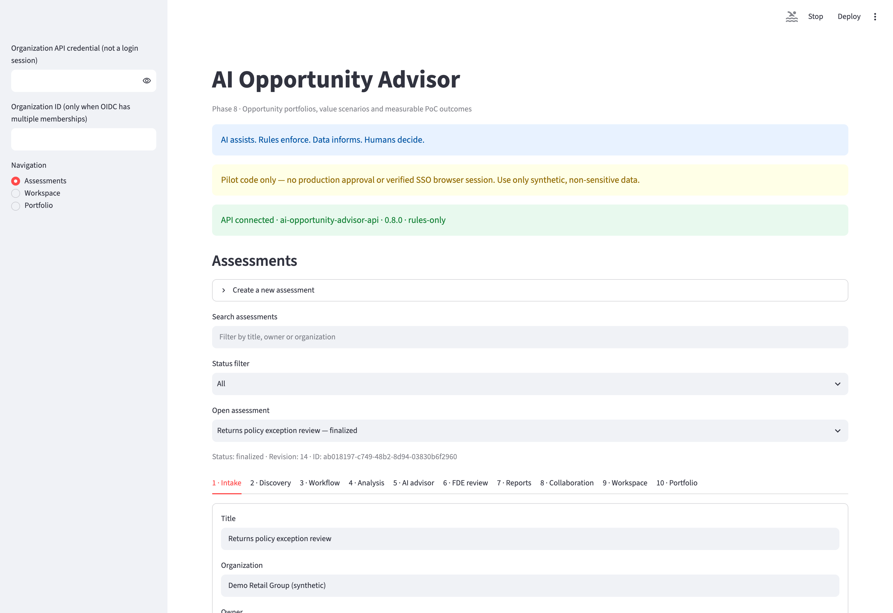
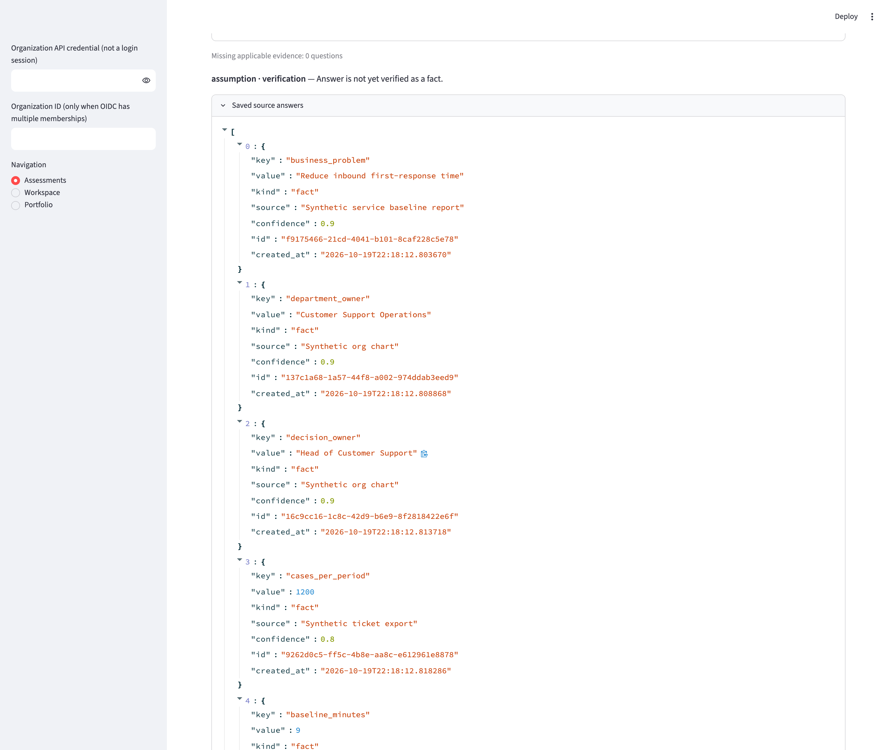
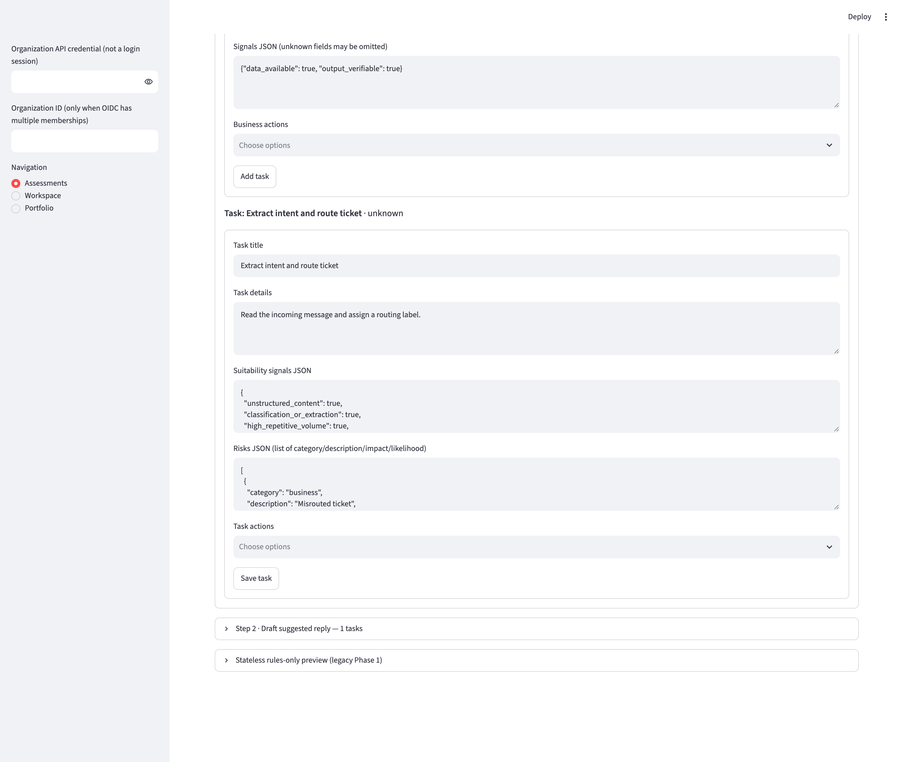
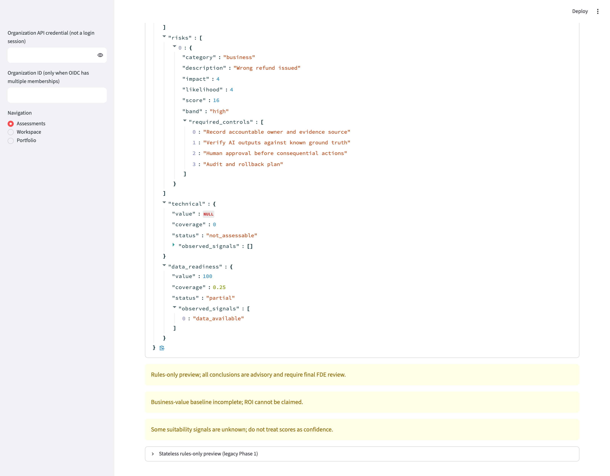
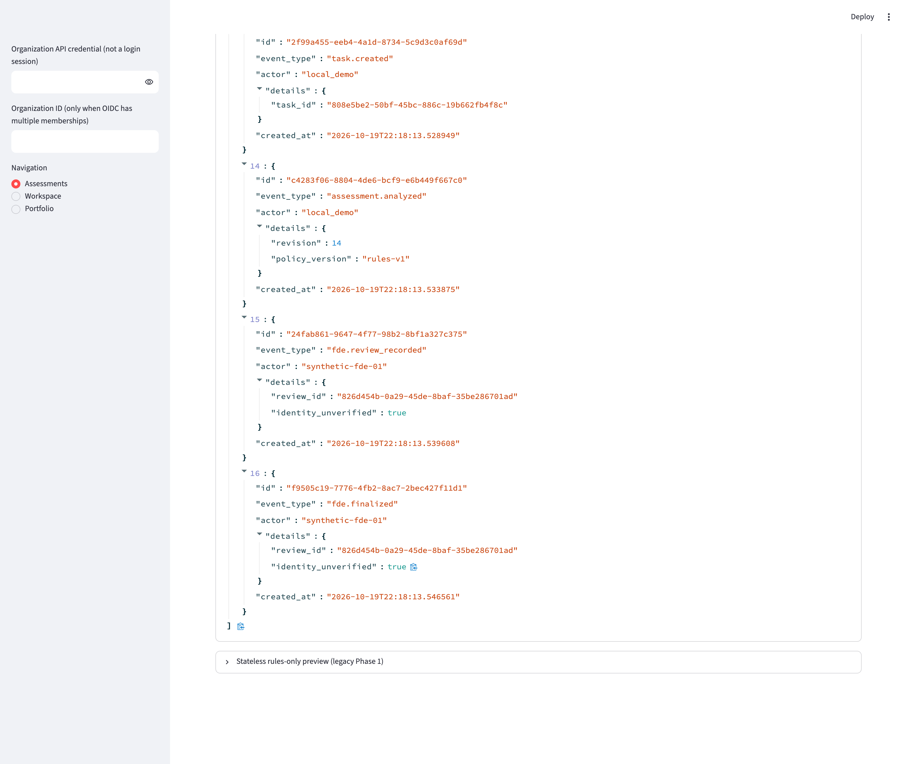
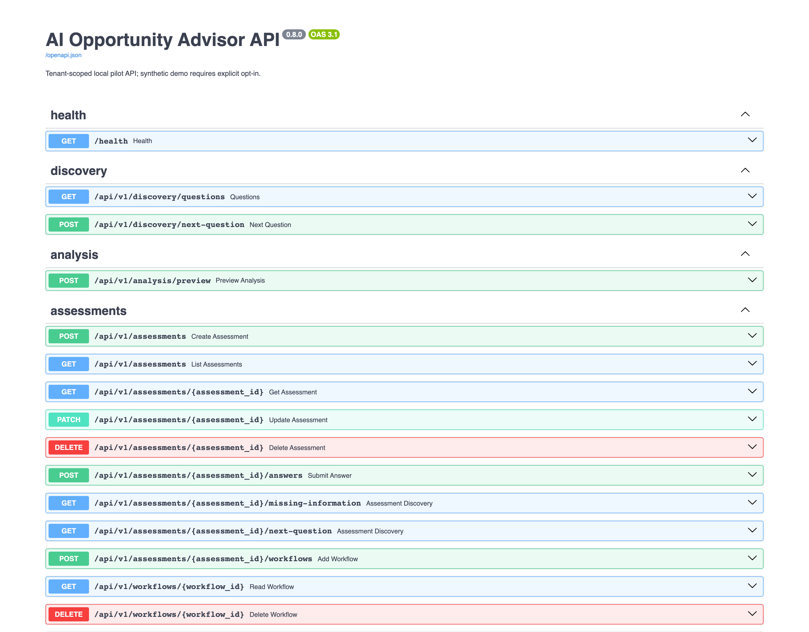

# Phase 4 demo, screenshot and smoke-test runbook

**Local synthetic data only. No hosted runner, external model, payments, or business-system execution.**

Every screenshot in `docs/images/` was produced by a headless Chrome session against a
running instance of this repository, with synthetic demo data only. Nothing in this
document is a mock-up, a placeholder or a hand-edited image. The exact commands that
regenerate them are in [Reproducing the screenshots](#reproducing-the-screenshots).

Related documents: [architecture.md](architecture.md) (design and boundaries),
[evaluation.md](evaluation.md) (what the four golden cases do and do not prove),
[security.md](security.md) and [operations.md](operations.md) (release gates),
[phase7.md](phase7.md) / [phase8.md](phase8.md) (collaboration and portfolio),
`docs/decisions/` (ADRs).

---

## 1. One-command offline decision and export demo

```bash
python -m scripts.demo --output demo_out
```

This creates an **isolated ephemeral SQLite database** via FastAPI TestClient and drives three saved workflows through API create → add steps and tasks → deterministic analyze → provisional FDE review → Markdown/HTML/PDF report export. It does **not** modify your configured production/dev database and does not finalize any decision or authorize rollout. Reports appear in `demo_out/` (Git-ignored). Expected outputs:

- `ai-support.{md,html,pdf}` → `strong_ai_candidate`
- `exact-pricing.{md,html,pdf}` → `traditional_software`
- `hybrid-refund.{md,html,pdf}` → `ai_human_approval` and approval controls

A fourth separate evaluation (`privacy-blocked`) asserts the external-provider permission gate.

This script needs no server, no database file and no network, so it is the fastest
reproducibility check. It does **not** populate a running UI, which is what
`scripts/seed_demo_data.py` (section 3) is for.

## 2. Full local runbook from a clean clone

Run the steps in this order. All commands are local and use synthetic data.

```bash
# 0. Dependencies (Python 3.12)
uv sync --extra dev --extra postgres

# 1. Baseline test suite (expected: 125 passed)
uv run --no-sync python -m pytest -q

# 2. Database schema for the demo instance
DATABASE_URL="sqlite:///$(pwd)/demo_capture.sqlite3" \
  uv run --no-sync alembic upgrade head
```

Terminal A — API (explicit local demo mode and a local reviewer token):

```bash
DATABASE_URL="sqlite:///$(pwd)/demo_capture.sqlite3" \
ADVISORY_DEMO_MODE=1 \
ADVISORY_REVIEW_TOKEN="local-demo-review-token-CHANGE-ME" \
  uv run --no-sync uvicorn app.main:app --host 127.0.0.1 --port 8000
```

Terminal B — UI (pointed at the local API):

```bash
API_BASE_URL="http://127.0.0.1:8000" \
  uv run --no-sync streamlit run ui/streamlit_app.py \
  --server.address=127.0.0.1 --server.port 8501 --server.headless=true
```

Terminal C — synthetic demo data through the public HTTP API:

```bash
ADVISORY_REVIEW_TOKEN="local-demo-review-token-CHANGE-ME" \
  uv run --no-sync python -m scripts.seed_demo_data --base-url http://127.0.0.1:8000
```

Then open <http://127.0.0.1:8501> and walk the tabs: **1 · Intake** →
**2 · Discovery** → **3 · Workflow** → **4 · Analysis** → **6 · FDE review** →
**7 · Reports** → **10 · Portfolio**. Use the sidebar **Portfolio** view for the
cross-assessment overview.

Stop both servers with `Ctrl-C` when the demo is finished. The demo SQLite file is
Git-ignored (`*.sqlite3`).

> `ADVISORY_REVIEW_TOKEN` is a local, throwaway demo secret used only to unlock the
> developer-demo finalization state transition. It is not an identity credential and
> does not authorize any rollout (ADR-0002, ADR-0005). The value above is a
> placeholder — replace it with your own local string of at least 16 characters.
> Never commit a real value, export it into a `.env` that is committed, or reuse it.

### What `scripts/seed_demo_data.py` creates

Four synthetic assessments in organization `Demo Retail Group (synthetic)`, all owned
by the synthetic reviewer `synthetic-fde-01`:

| Assessment | Engine result | Purpose in the demo |
| --- | --- | --- |
| Knowledge-base support triage | `strong_ai_candidate` (2 tasks) | AI case with evidence, ROI scenario and a **measured PoC whose target was met** |
| Exact pricing calculation | `traditional_software` | Non-AI case: exact arithmetic stays in typed code (`DET-001`, `MATH-001`) |
| Refund email workflow | `ai_human_approval` | Consequential action: hard rules `ACT-001` / `ACT-002`, PoC target **not** met |
| Returns policy exception review | `traditional_software` → **overridden** to `ai_human_approval` | FDE override with rationale, then finalized (local demo) |

The script only calls the public HTTP API; it never touches the database directly and
never calls an AI provider.

## 3. Screenshots of the running application

All images are 2× device-scale PNG screenshots of a 1600 px-wide viewport taken with
headless Chrome (`scripts/capture_screenshots.py`). They show the seeded synthetic
assessments described above.

### 3.1 Dashboard and assessment list



*Caption — assessment dashboard.* Search, status filter, "Open assessment" picker and
the ten phase tabs. The banner states `API connected · ai-opportunity-advisor-api ·
0.8.0 · rules-only`; the yellow notice is the permanent "pilot code only" warning.

### 3.2 Guided discovery — known / unknown / assumption tracker



*Caption — guided discovery.* Each answer carries a kind (`fact`, `assumption`,
`unknown`), a source and a self-reported confidence. The finding list is derived from
those kinds, so an unverified answer is shown as an **assumption**, not as a fact.
"Missing applicable evidence" counts the stock questions that still have no answer.

### 3.3 Workflow builder



*Caption — workflow builder.* Workflow → ordered step → atomic task. Each task is
evaluated on its own, and its signals, risks and business actions are editable here.
The business-action list is what later triggers the non-overridable approval rules.

### 3.4 Per-task analysis: score, hard-rule badges and controls


*Caption — per-task analysis.* The advisory suitability score is shown together with
its **evidence coverage** (0.3158) and an explicit warning that an incomplete signal
set is not certainty. `ACT-001` and `ACT-002` are the hard approval rules for an
irreversible, consequential action; they are listed with their severity and required
control and cannot be switched off by an FDE.

### 3.5 Risk register (impact / likelihood / score / band)



*Caption — risk register.* Risks are scored per task as impact × likelihood with a
band, and the data/technical readiness dimensions report their own coverage.
**There is no separate "risk matrix" screen in this build** — the register is rendered
per task in the analysis view and is also available as
`GET /api/v1/assessments/{id}/risks`.

### 3.6 AI / non-AI boundary


*Caption — AI / non-AI boundary.* Every task states what code does, what an AI
assistant may do, and what stays with the accountable human. For exact pricing the
engine answers "No LLM needed for this task" and records `MATH-001` (exact arithmetic
must use typed code, not LLM math).

### 3.7 Recommendation, evidence, ROI scenario and PoC go/no-go gate


*Caption — recommendation and gates.* Planning scores, the evidence registry, an
illustrative ROI scenario and the PoC metric live together. The PoC block is the
go/no-go gate: baseline, target, direction, the measured value and whether the target
was met. Values are self-reported observations, not validated causal impact.

### 3.8 FDE review with an override rationale


*Caption — FDE review and override.* The deterministic engine recommended
`traditional_software`; the FDE selected `ai_human_approval` and had to supply an
**override rationale** (the API returns HTTP 422 without one). The record also shows
`identity_unverified: true` — a typed reviewer name is not a verified identity, and
the "Record review" button is disabled because the assessment is finalized.

### 3.9 Final decision and audit trail



*Caption — final decision.* Finalization appends an audit event and makes the
assessment read-only; a guarded "Reopen finalized local demo" control exists. Every
audit row states that the actor identity was unverified.

### 3.10 Exported Markdown report


*Caption — exported report.* The preview is the exact Markdown returned by
`GET /api/v1/assessments/{id}/report?format=markdown` for the current revision. The
same report is available as HTML and as PDF (`?format=html`, `?format=pdf`); all
three are rendered from one internal section builder, so they cannot disagree
about what the assessment says (see [Phase 10 guide](phase10.md)). The
report labels assumptions and unknowns, states that no rollout is authorized, and is
reproducible from unchanged saved content (no wall-clock timestamp is injected).

### 3.11 Portfolio overview (Phase 8)


*Caption — portfolio.* Planning priorities are provisional. Only one assessment has a
planning profile and verified evidence, so the other three are shown as "need
evidence" with the missing factors listed — the portfolio does not invent a ranking.

### 3.12 API contract



*Caption — API surface.* The UI is a thin HTTP client; the authoritative contract is
`/openapi.json` (also documented in [architecture.md](architecture.md)).

### 3.13 Screens that deliberately do not exist

- **Enterprise approval chain** (technical → security → business): `POST
  /api/v1/assessments/{id}/approvals` returns HTTP 403 in local demo mode
  ("Enterprise approval requires an authenticated reviewer"), so no completed
  chain is shown. See [phase7.md](phase7.md).
- **AI advisor proposals** (tab `5 · AI advisor`): the tab requires an explicitly
  configured external provider plus an access token. No provider was used for these
  screenshots, so the tab is shown empty rather than faked.
- **PDF export**: delivered in Phase 10 as a server-side pipeline rendered from the
  same internal section builder as the Markdown and HTML exports
  (see [phase10.md](phase10.md) and [ADR-0015](decisions/0015-server-side-pdf-export.md)).
  These screenshots predate it, so the PDF is not shown here; the download button is
  on the reports tab.

## 4. Reproducing the screenshots

The capture script is a **documentation-only** helper. Playwright is intentionally not
a project dependency, so `pyproject.toml` and `uv.lock` are unchanged; install it into
the local environment only:

```bash
uv pip install playwright          # documentation capture only
```

It drives the locally installed Google Chrome (override with `CAPTURE_CHROME`):

```bash
# API and UI must already be running with seeded data (sections 2 and 3)
uv run --no-sync python -m scripts.capture_screenshots --output-dir docs/images
```

Notes and known quirks of the capture run:

- The script verifies the selected assessment after every dropdown change and retries,
  because Streamlit occasionally drops a widget update while the previous rerun is
  still in flight.
- It expands the `Rule hits, factors and risks` expander and the JSON tree nodes
  before capturing, so the rule ids and severities are actually readable.
- The API documentation image is captured from `http://127.0.0.1:8000/docs`.
- Screens are reproducible in content but not byte-identical: identifiers, timestamps
  and the recorded confidences differ per seeded run.

## 5. Docker Compose (local loopback binding)

```bash
docker compose up --build
```

Open `http://127.0.0.1:8501`; API health is `http://127.0.0.1:8000/health`. The API container migrates the SQLite database at startup; the UI waits for its health check. Compose binds both published ports to `127.0.0.1` only, disables AI provider access by default, and stores the demo SQLite database in a named Docker volume. Data remains after container removal until the volume is explicitly deleted.

> **Not production-ready:** HTTP endpoints are unauthenticated in demo mode, shared local reviewer tokens are not identity verification, and tenant isolation is not implemented. The container definitions have not been hardened for public multi-tenant use. Do not expose ports externally or upload real customer/regulated data.

## 6. Architectural and evaluation trade-offs

The design rationale lives in `docs/decisions/` (ADR-0001 … ADR-0008) and
[architecture.md](architecture.md); the evaluation caveats live in
[evaluation.md](evaluation.md). The trade-offs a demo viewer should keep in mind:

1. **Deterministic rules instead of a judging model.** `rules-v1` scores and
   recommendations are pure functions of recorded signals (ADR-0003). The price is
   that the score is only as good as the signals — the UI therefore always shows
   evidence coverage and refuses to present an incomplete score as certainty. The
   benefit is reproducibility: the same inputs always produce the same category.
2. **A report is a snapshot, not a live view.** Exports reproduce the current
   revision only; editing any input invalidates the analysis and the report returns
   HTTP 409 until it is re-scored (ADR-0004). This keeps exports honest but means a
   report can go stale quickly in a live workshop.
3. **Thin UI over a strict API.** Streamlit never touches the database or the scoring
   functions (ADR-0001). Every screenshot therefore reflects the same code path a
   scripted client would use, at the cost of extra latency on each rerun.
4. **Human override, non-overridable hard rules.** An FDE may select a different
   category if a rationale is recorded, but `ACT-001`, `ACT-002`, `HUM-001` and
   `PRIV-001` still apply. This is the deliberate split between advisory judgement
   and policy enforcement (ADR-0004, [security.md](security.md)).
5. **Local demo mode versus tenant-scoped access.** `ADVISORY_DEMO_MODE=1` removes
   authentication so the demo is reproducible; the production-shaped path uses
   organization-bound API tokens or OIDC (ADR-0005, ADR-0006). The screenshots show
   the *demo* mode, which is why every review is labelled `identity_unverified`.
6. **Planning intelligence is not business value.** The Phase 8 portfolio, ROI
   scenarios and PoC outcomes are operator-entered, single-currency and
   self-reported (ADR-0008, [phase8.md](phase8.md)). They are shown as planning
   evidence, never as validated ROI.

## 7. Known limitations

- The four golden cases in [evaluation.md](evaluation.md) are a regression suite, not
  a representative sample: `4/4` means the curated fixtures still match their
  expected categories on this version, nothing more. There are no live model calls,
  latency measurements, field outcomes or user studies behind any screenshot.
- No model output is visible anywhere in these screenshots. The optional AI advisor
  is disabled, so nothing in the images demonstrates model quality.
- Reviewer identity is a typed label. Finalization proves that *a* local token was
  presented, not who the reviewer is; the audit trail says so explicitly.
- Scores are advisory. Signal coverage is partial in most demo tasks (32 % and 42 %
  in the screenshots), which is exactly why the coverage figure is displayed next to
  every score.
- The portfolio ranking is provisional and evidence-bound: three of the four
  synthetic opportunities are unranked because no planning profile exists.
- Concurrency: revision bumps are not compare-and-swap updates, so concurrent writes
  on the local SQLite instance are not safe for real multi-user use
  ([architecture.md](architecture.md)).
- The capture helper needs Playwright and a local Chrome build; neither is part of
  the shipped dependency set, and the screenshots are therefore a manual,
  operator-driven artefact rather than a CI gate.

## 8. Manual smoke checklist

1. `alembic upgrade head` completes on a fresh database; `alembic check` reports no unapplied model migrations.
2. `/health` responds with HTTP 200 and `/openapi.json` includes `/api/v1/assessments/{assessment_id}/report`.
3. Offline pytest passes; `python -m app.evaluation` reports 4/4 curated cases.
4. `python -m scripts.demo` produces all six files; exact pricing prefers software and refund requires approval.
5. HTML escapes user-provided text rather than executing it; Markdown escapes injected formatting.
6. Reports return HTTP 409 for un-analyzed or edited assessments, and 404 for missing/deleted records.
7. Streamlit downloads all three formats without calling database or AI providers directly.
8. No external model or GitHub Actions runner was used.
9. `python -m scripts.seed_demo_data` against a running demo API creates the four
   synthetic assessments listed in section 2 with the expected statuses
   (`analyzed`, `in_review`, `in_review`, `finalized`).
10. `python -m scripts.capture_screenshots` writes the twelve PNGs listed in section 3
    from that live instance.
